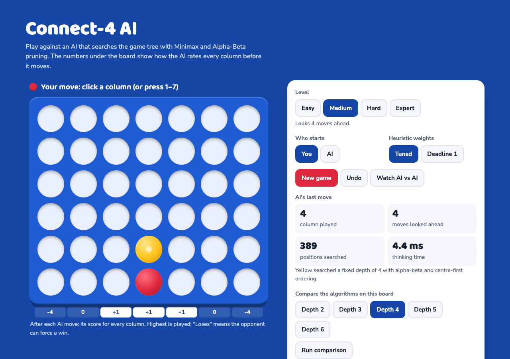

# Connect-4 AI

A Connect-4 game with an AI opponent built on minimax, alpha-beta pruning, move ordering and iterative deepening. Playable in the browser, in the terminal and in a Pygame window.

[](https://github.com/ArmaanBawa/connect4-ai/actions/workflows/tests.yml)
[](https://github.com/ArmaanBawa/connect4-ai/actions/workflows/pages.yml)

**Live demo: https://ArmaanBawa.github.io/connect4-ai/**



## Features

- **Four levels** in the web version: Easy, Medium and Hard search 2, 4 and 6 moves ahead (alpha-beta with centre-first ordering); Expert uses iterative deepening with a 1 second budget.
- **Per-column AI scores** shown under the board after every AI move.
- **Live minimax vs alpha-beta comparison** on any position: positions searched and time for plain minimax, alpha-beta, and alpha-beta with ordering.
- **AI vs AI mode** to watch the engine play itself.
- **Pygame GUI** with a level screen, falling-disc animation and a compare key.
- **Terminal game** (`python -m connect4`).
- **Benchmark and tuning scripts** that produce the numbers in this README (`experiments/`).
- The search engine exists twice, in Python (`src/connect4/`) and JavaScript (`web/js/engine.js`), each covered by its own tests.

## How it works

Connect-4 is a two-player, zero-sum game with perfect information, so the AI treats it as a game tree: every position is a node and every legal column is an edge. The AI looks a fixed number of moves ahead, scores the boards at that horizon with a heuristic (open threes and twos, centre control, a penalty for the opponent's open threes), and backs the scores up the tree with **minimax**. **Alpha-beta pruning** skips branches that cannot change the result, **centre-first move ordering** makes those cut-offs happen sooner, and **iterative deepening** searches depth 1, 2, 3, ... until a time limit is reached. The heuristic weights were tuned by **hill climbing** over self-play.

The details are in [docs/algorithms.md](docs/algorithms.md).

## Results

All numbers below come from [`results/results.json`](results/results.json) and [`results/tuning_results.json`](results/tuning_results.json), produced by `experiments/benchmark.py` and `experiments/tune.py`.

### Search cost: positions searched per move

Average over 8 mid-game test positions (4, 6 or 8 moves played). Node counts are averages rounded to whole numbers.

| Algorithm | Depth 2 | Depth 3 | Depth 4 | Depth 5 | Depth 6 |
|---|---:|---:|---:|---:|---:|
| Minimax | 57 | 395 | 2,726 | 18,426 | n/a |
| Alpha-beta | 36 | 175 | 680 | 2,981 | 10,732 |
| Alpha-beta + centre-first ordering | 25 | 100 | 243 | 946 | 2,571 |

Average time per move in milliseconds (Python, on the machine that ran the benchmark):

| Algorithm | Depth 2 | Depth 3 | Depth 4 | Depth 5 | Depth 6 |
|---|---:|---:|---:|---:|---:|
| Minimax | 2.0 | 12.5 | 82.4 | 576.0 | n/a |
| Alpha-beta | 1.0 | 5.0 | 19.0 | 88.0 | 305.6 |
| Alpha-beta + centre-first ordering | 0.6 | 2.6 | 5.8 | 25.3 | 68.4 |

`n/a`: `benchmark.py` does not run plain minimax above depth 5 because it takes too long.

At depth 5, alpha-beta searched about 16% of the positions minimax did (2,981 vs 18,426), and with centre-first ordering about 5% (946).

> **Note on the weights used.** `results.json` was recorded with the original hand-picked "Deadline 1" weights (`DEFAULT_WEIGHTS`). The code now defaults to the tuned weights, so re-running `benchmark.py` gives the same minimax counts but slightly different alpha-beta counts, and different match scores (the matches also involve random play). Minimax does not depend on the weights; alpha-beta pruning does.

### Win rates

| Match (20 games, sides alternate) | Won | Lost | Draw |
|---|---:|---:|---:|
| Alpha-beta depth 4 vs random | 20 | 0 | 0 |
| Alpha-beta depth 4 vs greedy (1-ply) | 18 | 1 | 1 |
| Alpha-beta depth 2 vs greedy (1-ply) | 20 | 0 | 0 |
| Alpha-beta depth 5 vs alpha-beta depth 2 | 15 | 4 | 1 |

### Heuristic tuning

Hill climbing started from the Deadline 1 weights and changed one weight by one step at a time, accepting a neighbour only if it beat the current best in self-play with more than a 55% score.

| Step | Candidate (change to the current best weights) | Score vs current best (depth 3, 24 games) |
|---|---|---:|
| 1 | open-three weight 5 → 7 | 58.3% (accepted, above the 55% threshold) |
| 2 | open-three weight 7 → 9 | 54.2% (rejected, local maximum) |
| Validation | tuned vs Deadline 1 weights, depth 4, 40 games | 52.5% |

**The gain is small.** The tuned weights (open three raised from 5 to 7) scored 58% against the old ones in the depth-3 tuning matches, but only 52% (52.5%) in the 40-game depth-4 validation. The original weights were already close to a local maximum, and 40 games is too few to tell 52% from an even match.

## How to run

All commands are run from the repository root.

**Web version.** Open the live demo, or serve it locally:

```bash
python -m http.server 8000 --directory web
# then open http://localhost:8000
```

**Python terminal game.**

```bash
PYTHONPATH=src python -m connect4
```

**Pygame GUI.**

```bash
pip install -r requirements.txt
python gui/connect4_gui.py
```

Keys: `1`/`2`/`3` choose the level, click to drop a disc, `C` compares minimax with alpha-beta on the current board, `R` restarts, `Esc` quits.

**Benchmark.** Prints node counts and win rates and **overwrites `results/results.json`**:

```bash
python experiments/benchmark.py
```

**Tune the heuristic.** Takes a few minutes and **overwrites `results/tuning_results.json`**:

```bash
python experiments/tune.py
```

**Tests.**

```bash
pip install pytest
python -m pytest        # Python: board, search
node --test tests/      # JavaScript engine (Node 18+, no npm dependencies)
```

## Project structure

```
connect4-ai/
├── README.md
├── LICENSE
├── requirements.txt
├── pytest.ini
├── src/connect4/          Python package
│   ├── board.py           board, moves, win check
│   ├── heuristic.py       weights, score_window, evaluate
│   ├── search.py          minimax, alphabeta, iterative_deepening, best_move, Stats
│   ├── cli.py             terminal play
│   └── __main__.py        python -m connect4
├── gui/connect4_gui.py    Pygame game
├── experiments/
│   ├── benchmark.py       node counts, timings, win rates
│   └── tune.py            hill-climbing weight tuning
├── results/               measured output of the experiments (JSON)
├── web/                   the site deployed to GitHub Pages
│   ├── index.html
│   ├── css/style.css
│   └── js/engine.js, ui.js
├── tests/                 pytest + node:test
├── docs/
│   ├── algorithms.md
│   └── screenshots/
└── .github/workflows/     tests.yml, pages.yml
```

## Team AIChampions

| Member | Role |
|---|---|
| Armaan Bawa (Team Leader) | Alpha-beta search, integration, planning |
| Madhav Singla | Board engine and minimax core |
| Anubhav Raj | Heuristic function and weight tuning |
| Aman Goel | Benchmarks, testing, win-rates |
| Krish Tatwal | Game interface and demo video |
| Jatin Kumar | Research, references, report and slides |

## Course

ITITC503 Artificial Intelligence

## References

1. Russell, S. & Norvig, P. *Artificial Intelligence: A Modern Approach*, 4th ed., 2020.
2. Rich, E. & Knight, K. *Artificial Intelligence*, 1991.
3. Knuth, D. E. & Moore, R. W. "An analysis of alpha-beta pruning". *Artificial Intelligence* 6(4), 1975.
4. Shannon, C. E. "Programming a computer for playing chess". *Philosophical Magazine*, 1950.
5. Allis, V. *A Knowledge-based Approach of Connect-Four*. M.Sc. thesis, VU Amsterdam, 1988.
6. Pearl, J. *Heuristics*, 1984.

## License

[MIT](LICENSE), copyright 2026 Team AIChampions.
